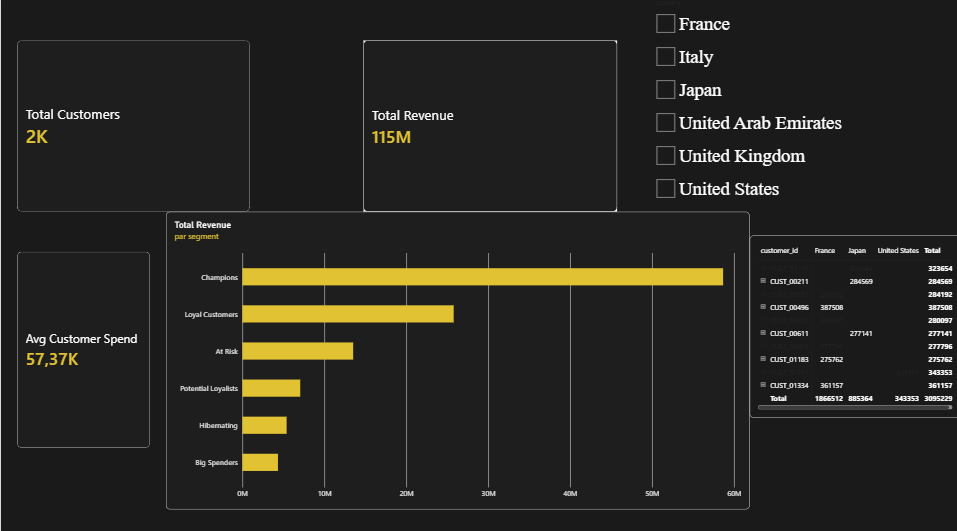

# 💎 Luxury Retail Analytics — Customer Intelligence & RFM Segmentation Dashboard

<p align="center">
  
</p>

---

## Executive Summary

This project delivers an end-to-end business intelligence solution tailored for high-end luxury houses (*Maison de Luxe* — Joaillerie, Horlogerie, Maroquinerie). Designed to align with the analytical standards of leading prestige groups like **LVMH, Hermès, and Kering**, this interactive platform synthesizes customer lifetime value, RFM (Recency, Frequency, Monetary) segmentation, and high-net-worth client dynamics (VIP / VIC identification). All datasets used in this project are synthetically generated for educational and analytical purposes. No real customer or company data is used.

The architecture spans the full data analytics lifecycle:
1. **Data Engineering & Preparation** via Python (`pandas`, `numpy`).
2. **Relational Querying & Scoring** via SQL (`sqlite3`) and custom Python scoring logic.
3. **Interactive Executive Visualization** via Power BI (*Minimalist Dark & Gold Theme*).

---

## 🛠️ Technical Architecture & Stack

| Layer | Technology | Usage & Functionality |
| :--- | :--- | :--- |
| **Data Engine** | `Python 3.10+` | Dataset orchestration, transaction modeling, RFM score calculation |
| **Database** | `SQL (SQLite)` | Relational querying, aggregation, customer segment storage |
| **Visual Analytics** | `Power BI Desktop` | Interactive dashboarding, dynamic slicers, DAX measures (`Total Revenue`, `Total Customers`, `Avg Customer Spend`) |
| **Documentation** | `Markdown / VS Code` | Technical reporting and executive insights |

---

## 📊 Business Metrics & Key Performance Indicators

- **Total Revenue:** `€114.74M`
- **Registered Clients:** `2,000`
- **Active Buyers (with purchases):** `1,971`
- **Total Transactions:** `15,000`
- **Average Spend per Active Client:** `~€€58.21K`

---

## 💻 Relational Database Interrogation (`sql/queries.sql`)

```sql
-- ============================================================
-- LUXURY RETAIL ANALYTICS — CUSTOMER INTELLIGENCE QUERIES
-- ============================================================

-- 1. Revenue & Transaction Volume by Customer RFM Segment
SELECT 
    segment,
    COUNT(DISTINCT customer_id) AS total_customers,
    ROUND(SUM(monetary), 2) AS total_revenue,
    ROUND(AVG(monetary), 2) AS average_customer_spend
FROM customer_rfm
GROUP BY segment
ORDER BY total_revenue DESC;

-- 2. Top 10 High-Net-Worth VIP Customers
SELECT 
    c.customer_id,
    c.country,
    r.segment,
    ROUND(r.monetary, 2) AS total_revenue
FROM customer_rfm r
JOIN customers c ON r.customer_id = c.customer_id
ORDER BY total_revenue DESC
LIMIT 10;

-- 3. Revenue Breakdown by Market / Country
SELECT 
    c.country,
    COUNT(DISTINCT t.customer_id) AS active_buyers,
    ROUND(SUM(t.total_amount), 2) AS total_revenue
FROM transactions t
JOIN customers c ON t.customer_id = c.customer_id
GROUP BY c.country
ORDER BY total_revenue DESC;
```

---

## 🎯 Strategic Business Recommendations

### 1. Tailored Engagement for "Champions" & Top VIPs
- **Finding:** The top-tier segments drive a massive concentration of total revenue relative to their headcount.
- **Action:** Deploy exclusive clienteling initiatives (private salon viewings, bespoke product pre-orders, dedicated personal advisors) across core flagship markets (Paris, Tokyo, New York).
  
### 2. Reactivation Strategy for "At Risk" High-Spenders
- **Finding:** A subset of clients with high historical monetary value show declining recency scores.
- **Action:** Implement targeted, personalized re-engagement campaigns curated around high-end product novelties and private events to recover slipping customer equity.
  
### 3. Nurturing "Potential Loyalists" & "New Customers"
- **Finding:** Recent adjustments to segmentation logic accurately capture newly acquired buyers entering the ecosystem.
- **Action:** Design streamlined onboarding touchpoints and welcome experiences to transition single-purchase clients into recurring brand loyalists.

### 4. Cross-Border Market Optimization
- **Finding:** Regional filtering via international slicers reveals distinct purchasing behaviors across markets (France, USA, Japan).
- **Action:** Tailor local stock allocation and marketing communication to align with regional preferences in high jewelry, watchmaking, and leather goods.
---

<p align="center">
  <i>Designed for Executive Analytics & Luxury Retail Strategy</i>
</p>
